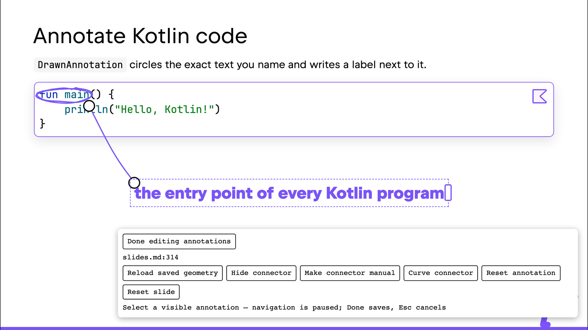

# Slidev Theme Kotlin

A [Slidev](https://sli.dev) theme for Kotlin talks: code windows that look
like IntelliJ, the decorations your IDE shows, hand-drawn annotations, and
Kodee.

**[See the demo deck](https://nomisrev.github.io/slidev-theme-kotlin/)**. Its
source is [`slides.md`](slides.md), so every slide doubles as an example.

## Quick start

You need Node.js 20.12 or newer. Install the theme in your Slidev project:

```bash
npm install slidev-theme-kotlin
```

With pnpm, set `shamefully-hoist=true` in `.npmrc`.

Then name the theme at the top of `slides.md`:

```yaml
---
theme: kotlin
transition: fade
themeConfig:
  kodee: greeting
---

# Your Presentation Title
```

## Contents

- [Code windows](#code-windows)
- [Folded imports](#folded-imports)
- [Magic Move between slides](#magic-move-between-slides)
- [IDE decorations](#ide-decorations)
- [Drawn annotations](#drawn-annotations)
- [Kodee](#kodee)
- [Layouts](#layouts)
- [Customising](#customising)
- [Publishing a deck](#publishing-a-deck)
- [Compiling the snippets](#compiling-the-snippets)
- [Tips](#tips)
- [Developing the theme](#developing-the-theme)

## Code windows

Every code fence is drawn as an IntelliJ editor, Light or Darcula with the
deck's colour scheme. An icon in the top-right corner and the border colour
say what kind of code it is:

````md
```kotlin
fun main() = println("Hello")
```

```kotlin gradle
plugins { kotlin("jvm") }
```
````

| Fence | Icon |
| --- | --- |
| `kotlin`, `kt`, `kts` | Kotlin |
| `kotlin gradle` | Gradle |
| `kotlin ktor` | Ktor |
| `kotlin arrow` | [Arrow](https://arrow-kt.io) |
| `kotlin jdbc`, `kotlin r2dbc` | JDBC, R2DBC |
| `java` | Java |
| `bash` | Terminal |
| `sql` | PostgreSQL |
| `yaml toolchain` | Amper |
| `xml maven` | Maven |

The modifiers work with `kt` and `kts` too, and inside Magic Move. Any other
fence is a plain code window.

### Program output

A `console` fence is output, not code. It looks like IntelliJ's Run tool
window. Put it under the fence whose output it shows:

````md
```kotlin
println(listOf(1, 2, 3).map { it + 1 })
```

```console
[2, 3, 4]
```
````

## Folded imports

A snippet reads best without its imports, but a snippet that has them is
complete: it compiles, and a reader of the handout can see where every symbol
comes from. So write the imports, and the theme hides them on the slide:

````md
```kotlin
import kotlinx.coroutines.flow.Flow
import kotlinx.coroutines.flow.flowOf

fun numbers(): Flow<Int> = flowOf(1, 2, 3)
```
````

The slide shows only `fun numbers()…`. The handout and `llms-full.txt` print
the fence in full.

### Hide more than imports

When an example needs a table definition or a helper, put a `// Example`
comment where the example starts. Everything above it stays off the slide,
and so does the comment:

````md
```kotlin
import kotlinx.coroutines.flow.Flow
import kotlinx.coroutines.flow.flowOf
import kotlinx.coroutines.flow.map

fun numbers(): Flow<Int> = flowOf(1, 2, 3)

// Example: reuse the flow above without showing it
fun doubled(): Flow<Int> = numbers().map { it * 2 }
```
````

The text after the colon is optional.

### Hide the answer of an exercise

Put the answer above a `// Solution` comment. It folds like `// Example`, and
the snippet checker compiles the assertions against it. The handout and
`llms-full.txt` leave the answer out (they keep its `import` lines), and
nothing on the slide can reveal it:

````md
```kotlin
fun Int.isEven(): Boolean = this % 2 == 0

// Solution
check(4.isEven())
check(!7.isEven())
```
````

### Details

- Kotlin, Java, and Scala fences fold (`kotlin`, `kt`, `kts`, `java`,
  `scala`).
- Without a marker, only the block of `import` lines at the top folds. A
  `package` line or `@file:` annotation before it stays visible.
- Only the first `// Example` or `// Solution` line in a fence counts, and
  only when there is code above it.
- Line numbers, `{1|2-3}` highlight ranges, and annotation targets count from
  the first visible line, so folding never shifts them.
- Magic Move folds too, step by step.
- To show the imports, add `show-imports` to one fence
  (`` ```kotlin show-imports ``) or set `themeConfig: { foldImports: false }`
  for the whole deck.

## Magic Move between slides

Slidev's Magic Move animates code inside one slide. This theme can also morph
code **from one slide to the next**: put `magic-move` in the separator
between them.

````md
# My Slide

```kotlin
class Person
```

---
magic-move
---

# My Slide

```kotlin
class Person(val name: String)
```
````

- Repeat the separator to chain any number of slides. The last slide of a
  chain needs no marker.
- Code windows pair up by position: the first fence morphs into the first
  fence of the next slide, the second into the second. Kotlin next to SQL
  animates side by side.
- Everything outside the fences is a normal slide. Headings and text can
  change freely.
- Navigating backward plays the animation in reverse.
- Icons, `[Title]` labels, `{lines:true}`, and click highlighting such as
  `` ```kotlin {1|2-3} `` all work.
- `magicMove: true` in a slide's frontmatter does the same as the bare
  separator, and combines with other frontmatter keys.
- Snippet imports (`<<< @/...`) do not take part in a chain.
- Use `transition: fade`. With `transition: view-transition`, Slidev 52
  stalls for a moment on many navigations.

## IDE decorations

Show what the IDE shows: smart casts, warnings, errors, receiver hints,
debugger values, and suspension points. Ask for one with a trailing
`// [!kind …]` comment on the line it belongs to:

````md
```kotlin
fun Application.users() = routing { // [!this Routing]
  route(Api.Users.create) { // [!this TypedRespondScope<CreateUser, User>]
    when (val result = insertUser(body)) {
      is Success -> respond(result.user) // [!smartcast result]
      AlreadyExists -> fail(UserAlreadyExists)
    }
  }
}
```
````

The comment never reaches the slide, the handout, or the compiled snippets.

| Mark | What appears |
| --- | --- |
| `[!smartcast TEXT]` | Green smart-cast background behind `TEXT` |
| `[!warning TEXT MESSAGE]` | Yellow warning background, with the message after the line |
| `[!error TEXT MESSAGE]` | Red squiggle under `TEXT`, with the message after the line |
| `[!this TYPE]` / `[!context TYPE]` | Grey `this: TYPE` hint after the line's `{` |
| `[!type NAME TYPE]` | Inferred-type hint after `NAME` |
| `[!value TEXT VALUE]` | Debugger value after the line |
| `[!suspend]` | Suspend-call icon in the gutter |

Quoting, options such as `on=1`, and several marks on one line are covered in
[`docs/code-marks.md`](docs/code-marks.md).

### As components

Each decoration is also a component that wraps one fence. Use it when the
decoration should appear on a click, or around a classic ````md magic-move````
block:

````md
<InlineCompilerError text="userName" message="Unresolved reference: userName" :on="1">

```kotlin
println(userName)
```

</InlineCompilerError>
````

The props of
[`InlineCompilerError`](components/README.md#inlinecompilererror),
[`SmartCast`](components/README.md#smartcast),
[`Warning`](components/README.md#warning),
[`TypeHint`](components/README.md#typehint),
[`InlineValue`](components/README.md#inlinevalue), and
[`SuspendGutter`](components/README.md#suspendgutter) are in
[`components/README.md`](components/README.md).

## Drawn annotations

`<DrawnAnnotation>` draws a hand-drawn mark on an element or on exact text
inside a code block, and can connect it to a label or to another element:

````md
<DrawnAnnotation type="circle" text="fun main" label="program entry point" :on="1">

```kotlin
fun main() = println("Hello, Kotlin!")
```

</DrawnAnnotation>
````

- Marks: `underline`, `circle`, `box`, `strike-through`.
- Labels take a little Markdown: `` `code` ``, `**strong**`, `*emphasis*`,
  `>` quotes, and line breaks.
- It follows Magic Move steps and Slidev's clicks.

Every prop, the click timing, and troubleshooting are in
[`components/README.md`](components/README.md#drawnannotation).

### Visual editor

Drag labels and connectors into place while the deck runs, instead of typing
coordinates. Turn it on in the deck's `vite.config.ts`:

```ts
import { defineConfig } from 'vite'
import { drawnAnnotationEditor } from 'slidev-theme-kotlin/annotation-editor'

export default defineConfig({
  plugins: [drawnAnnotationEditor()],
})
```



Then, in `slidev dev`:

1. Press **Alt+Shift+A** (**⌥⇧A** on a Mac) on the slide you want to edit. Navigation pauses
   until you leave the editor.
2. Drag a label, its width handle, or a connector. The arrow keys nudge the
   selected control (**Shift** for larger steps).
3. Press **Done editing annotations**. The positions are saved as a
   `:geometry` attribute on the tags you edited.

**Esc** cancels: first a drag, then the selection, then the whole session.
The toolbar can also hide, curve, or reset a connector. Nothing of the editor
is part of a built or exported deck. The details are in
[Visual-editor geometry](components/README.md#visual-editor-geometry).

### When an annotation finds nothing

In `slidev dev`, a red chip in the top-left corner of the slide tells you
that an annotation or decoration could not find its text or element. Hover it
for the message; the console prints the same. See
[When nothing appears](components/README.md#when-nothing-appears).

## Kodee

Turn the mascot on once for the whole deck:

```yaml
---
theme: kotlin
themeConfig:
  kodee: greeting
---
```

Kodee sits small in the bottom-right corner of regular slides, and large
beside the title on `cover` and `intro` slides. Between slides it glides to
its new place.

Change the expression for one slide, or hide the mascot:

```yaml
---
kodee: wink    # or: kodee: false
---
```

The variants are `greeting`, `wink`, `wave`, `jumping`, `sitting`,
`drinking`, `heart`, `in-love`, `welcome`, `winter`, and `tiny`.

### Size and position

Use the object form for full control:

```yaml
---
kodee:
  variant: greeting
  size: large
  position: featured
---
```

| Key | Values | Default |
| --- | --- | --- |
| `variant` | one of the variants above | the deck's `themeConfig.kodee` |
| `size` | `small` (200px), `medium` (320px), `large` (600px; 500px for `wave`) | `small`; `large` on `cover` and `intro` |
| `position` | `corner`, `featured`, `custom` | `corner`; `featured` on `cover` and `intro` |
| `x`, `y` | pixels, with `position: custom` | – |
| `scale` | a multiplier, `1.2` for a fifth larger | `1` |

## Layouts

| Layout | Use |
| --- | --- |
| `default` | A regular slide |
| `cover` | The title slide, with the text beside a large Kodee |
| `intro` | A section or speaker introduction, same arrangement as `cover` |

```yaml
---
layout: cover
---

# Presentation Title
```

Slidev's built-in layouts, such as `two-cols-header`, keep working.

## Customising

Colours, sizes, and fonts are CSS variables. Override them in the deck's own
stylesheet (`style.css` or `styles/index.css`).

### Code-window colours

Each icon has a border colour, with a light and a dark value:

```css
:root {
  --code-window-kotlin-color: #834df0;
  --code-window-gradle-color: #6c707e;
  --code-window-amper-color: #087cfa;
  --code-window-arrow-color: #2455cf;
  --code-window-ktor-color: #7f52ff;
  --code-window-java-color: #e66d17;
  --code-window-terminal-color: #6c707e;
  --code-window-maven-color: #3574f0;
  --code-window-postgresql-color: #336791;
  --code-window-jdbc-color: #f59e0b;
  --code-window-r2dbc-color: #06b6d4;

  /* The `console` output panel. */
  --code-window-output-background: #f7f8fa;
  --code-window-output-color: #2b2d30;
}

html.dark {
  --code-window-kotlin-color: #a571e6;
  --code-window-output-background: #1e1f22;
  --code-window-output-color: #bcbec4;
  /* Override any of the other dark-mode values as needed. */
}
```

The editor surface reads `--editor-bg`, `--editor-fg`, `--editor-border`, and
`--editor-shadow`. `--code-window-border` overrides the border of one window.

### Code size

Every code window uses one font size, chosen so that a full-width window fits
80 characters. Change the number of columns for the deck, or for one slide
class:

```css
:root {
  --code-window-columns: 72;
}
```

| Variable | Default | Use |
| --- | --- | --- |
| `--code-window-columns` | `80` | Characters that fit a full-width window |
| `--code-window-font-size` | from the columns | Set a size such as `1.25rem` and skip the calculation |
| `--code-window-inline-space` | the standard layout's | Horizontal padding, for a custom layout |
| `--code-window-character-width` | `0.61` | Width of one character relative to the font size; change it for another monospace font |
| `--code-window-line-height` | `1.42` | Line height |

### Cover text width

On `cover` and `intro` slides the text sits in a column beside Kodee. The
column is `--cover-text-width`, 48% by default. Widen it when the titles are
short, or give a slide without the mascot the full width:

```css
.slidev-layout.cover.no-mascot {
  --cover-text-width: 100%;
}
```

### Fonts

The theme uses JetBrains Sans and JetBrains Mono when they are installed on
your machine. Otherwise it falls back to Inter and to JetBrains Mono from
Google Fonts.

### `themeConfig` reference

| Key | Default | Use |
| --- | --- | --- |
| `kodee` | off | The deck's [Kodee](#kodee) variant, or the object form |
| `foldImports` | `true` | `false` keeps every import visible |
| `drawnAnnotation.connect` | `true` | `false` draws labels without a line to their mark |
| `siteUrl` | – | The deck's public URL, for [publishing](#publishing-a-deck) |
| `handout` | on | `false` turns the static handout off; `handout.notes: false` leaves presenter notes out |
| `analytics.goatcounter` | – | A GoatCounter site, to count pageviews |
| `snippets` | – | Where [compiled snippets](#compiling-the-snippets) go |

## Publishing a deck

A built Slidev deck is a JavaScript app, so search engines and AI crawlers
see none of your code. Every `slidev build` on this theme therefore also
writes a static **handout** (`handout/index.html`), **`llms.txt`** and
**`llms-full.txt`**, and a sitemap. Give the deck its public URL so the links
are absolute:

```yaml
themeConfig:
  siteUrl: https://example.github.io/my-deck/
```

On GitHub Pages, build with the hash router so deep links resolve:

```bash
slidev build --base /my-deck/ --router-mode hash
```

To count pageviews per slide without cookies, add a
[GoatCounter](https://www.goatcounter.com) site:

```yaml
themeConfig:
  analytics:
    goatcounter: mysite
```

What each file contains, `robots.txt`, and what is counted are in
[`docs/publishing.md`](docs/publishing.md).

## Compiling the snippets

`slidev-kotlin-snippets` turns the Kotlin and Java fences of a deck into
source files, so a Gradle module can compile them against the real libraries.
A stale slide then fails the build instead of the talk.

```yaml
themeConfig:
  snippets:
    dir: src/main/kotlin/snippets
    package: snippets
```

```bash
npx slidev-kotlin-snippets            # writes the files, removes stale ones
npx slidev-kotlin-snippets --check    # exits 1 when they are out of date (CI)
```

Add `no-compile` to a fence that is not meant to compile
(`` ```kotlin no-compile ``). The Gradle wiring, the remaining options, and
how fences map to files are in [`docs/snippets.md`](docs/snippets.md).

## Tips

### IntelliJ's Reformat Code

IntelliJ treats only the first YAML block of a Markdown file as frontmatter,
so **Reformat Code** breaks the frontmatter of later slides. Enable formatter
tags and switch formatting off after the headmatter:

```ini
# .editorconfig
[*.md]
ij_formatter_tags_enabled = true
```

```md
---
theme: kotlin
---

<!-- @formatter:off -->
```

## Developing the theme

`slides.md` is the demo deck. `slides.fixtures.md` holds edge cases for the
visual review and is not published.

| Command | What it does |
| --- | --- |
| `npm run dev` | Serve the demo deck with hot reload |
| `npm run build` | Lint and build the demo deck |
| `npm test` | Unit tests |
| `npm run test:annotation-editor` | Browser test of the visual editor |
| `npm run visual:review` | Compare screenshots of the working tree with the last commit |
| `npm run export` | Export the demo deck to PDF |
| `npm run screenshot` | Export every slide and click state as PNG |
| `npm run export:slide -- --slide 12 --click 3` | Export one slide as PNG; `--click` starts at 0 |

### Visual review

`npm run visual:review` renders every click state of both decks twice, for
the working tree and for a Git revision, and writes a page with base,
current, and diff side by side. Open the `file://` path it prints.

```bash
npm run visual:review                        # against the last commit
npm run visual:review -- --base origin/main  # against a branch
npm run visual:check -- --base origin/main   # fail on any difference
```

No screenshots are committed: the Git revision is the baseline, so you accept
a visual change by committing it. If Chromium is missing, install it once
with `npx playwright install chromium`.

## License

Apache License 2.0. See [LICENSE](LICENSE).

## Credits

- **Kodee** and the Kotlin logo: JetBrains
- **Slidev**: [Anthony Fu](https://github.com/antfu)

## Links

- [Slidev documentation](https://sli.dev)
- [Kotlin](https://kotlinlang.org)
- [Package on npm](https://www.npmjs.com/package/slidev-theme-kotlin)
