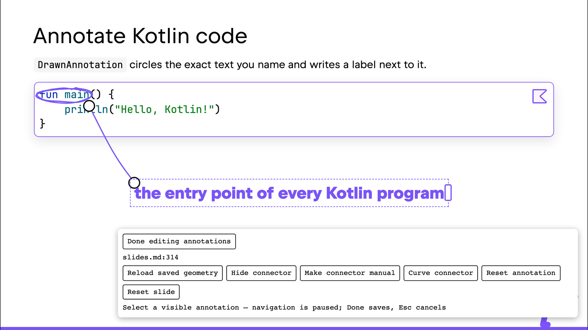
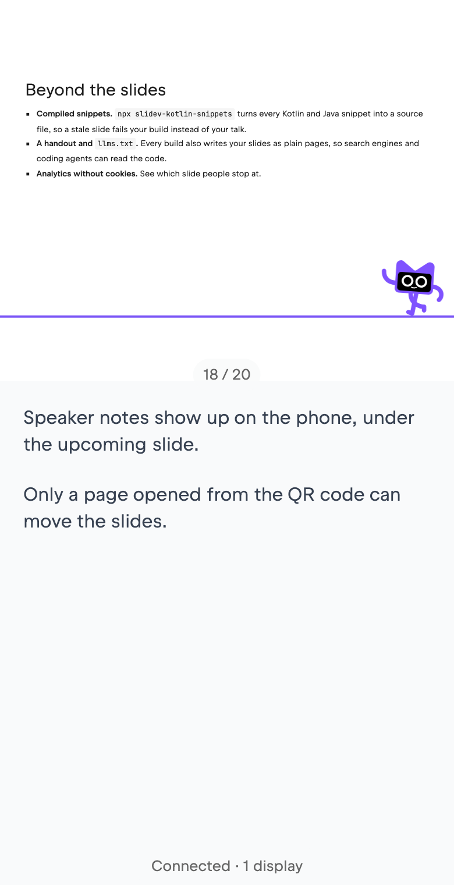

<!-- @formatter:off -->

# Kotlin Slidev Theme

## Slides that look like your IDE

`npm install slidev-theme-kotlin`

---
layout: intro
---

# Meet Kodee

The Kotlin mascot comes with every layout.

- One line of config turns Kodee on for the whole deck
- Kodee glides from one slide to the next instead of popping in

---
kodee:
  variant: jumping
  size: large
  position: featured
---

# Kodee follows your story

Each slide picks an expression, a size, and a place.

`greeting` `wink` `wave` `jumping`

`sitting` `drinking` `heart` `in-love`

`welcome` `winter` `tiny`

Or `kodee: false`, when a slide needs the room.

---
kodee: false
---

# Code looks like your IDE

```kotlin
val numbers = listOf(1, 2, 3)
println(numbers.map { it + 1 })
println(numbers.groupBy { it % 2 })
```

```console
[2, 3, 4]
{1=[1, 3], 0=[2]}
```

IntelliJ's editor for the code, its Run window for a `console` fence. Light and dark.

---
kodee: false
---

# Every code window says what it is

A word after the language picks the icon and the border colour.

<div class="grid grid-cols-3 gap-x-5">
<div>

`kotlin`

```kotlin
val answer = 42
```

`kotlin gradle`

```kotlin gradle
kotlin("jvm")
```

`kotlin ktor`

```kotlin ktor
get("/") { }
```

`kotlin arrow`

```kotlin arrow
either { bind() }
```

</div>
<div>

`kotlin jdbc`

```kotlin jdbc
transaction { }
```

`kotlin r2dbc`

```kotlin r2dbc
rows.asFlow()
```

`java`

```java
record User() {}
```

`sql`

```sql
SELECT * FROM talks;
```

</div>
<div>

`bash`

```bash
./gradlew test
```

`yaml toolchain`

```yaml toolchain
product: jvm/app
```

`xml maven`

```xml maven
<version>1</version>
```

</div>
</div>

---
kodee: false
---

# Write complete code, show what matters

Imports, and everything above a `// Example` comment, stay off the slide. The handout keeps them.

<div class="grid grid-cols-2 gap-x-5">
<div>

You write

```text
import kotlinx.coroutines.flow.*

fun numbers() = flowOf(1, 2, 3)

// Example
fun doubled() =
    numbers().map { it * 2 }
```

</div>
<div>

The slide shows

```kotlin
import kotlinx.coroutines.flow.*

fun numbers() = flowOf(1, 2, 3)

// Example
fun doubled() =
    numbers().map { it * 2 }
```

</div>
</div>

`// Solution` does the same for the answer of an exercise, and keeps it out of the handout too.

---
kodee: false
---

# Walk through the code, click by click

Line ranges after the language dim everything else. A `|` starts the next click.

`` ```kotlin {1-2,6|4} ``

```kotlin {1-2,6|4}{lines:true}
val numbers = listOf(1, 2, 3)
val doubled = numbers.map { it * 2 }

val evens = numbers.filter { it % 2 == 0 }

println(doubled)
```

First lines 1, 2 and 6, then line 4. `{lines:true}` adds the numbers.

---
kodee: wink
---

# Magic Move between slides

Put `magic-move` in the separator between two slides and the code morphs across them.

```kotlin
class Person
```

```sql
CREATE TABLE PERSON
```

---
magic-move
---

# Magic Move between slides

Each step is a full slide, so the title and the text can change with the code.

```kotlin
class Person(val name: String)
```

```sql
CREATE TABLE PERSON(
    name VARCHAR(255) NOT NULL
)
```

---
magic-move
---

# Magic Move between slides

Several code windows move together: the first into the first, the second into the second.

```kotlin
class Person(val name: String, val age: Int)
```

```sql
CREATE TABLE PERSON(
    name VARCHAR(255) NOT NULL,
    age  INT NOT NULL
)
```

---
kodee: false
---

# Show what the IDE shows

A trailing `// [!…]` comment asks for the decoration on its line, and never reaches the slide.

```kotlin
suspend fun render(shape: Shape) = buildString { // [!this StringBuilder]
  when (shape) {
    is Circle -> append(shape.radius) // [!smartcast shape]
    is Square -> append(shape.side) // [!smartcast shape]
  }
  delay(100) // [!suspend]
}
```

Here: `[!this StringBuilder]`, `[!smartcast shape]`, and `[!suspend]`.

---
kodee: false
---

# Warnings and errors

```kotlin
fun greet(name: String): Int {
    val greeting = "Hello" // [!warning greeting Variable 'greeting' is never used]
    return name // [!error name Type mismatch: required Int, found String]
}
```

`[!warning greeting …]` and `[!error name …]`. A snippet with an error is left out of the compiled sources.

---
kodee: false
---

# Values, like the debugger

<InlineValue :line="1" text="listOf(1, 2, 3)" value="[2, 3, 4]">
<InlineValue :line="2" text="listOf(1, 2, 3)" value="[[1, 2], [2, 3], [3, 4]]" :at="1">
<InlineValue :line="3" text="listOf(1, 2, 3)" value="[1, 2, 2, 3, 3, 4]" :at="2">

```kotlin
listOf(1, 2, 3).map { it + 1 }
listOf(1, 2, 3).map { listOf(it, it + 1) }
listOf(1, 2, 3).flatMap { listOf(it, it + 1) }
```

</InlineValue>
</InlineValue>
</InlineValue>

Every decoration is also a component, for when it should appear on a click.

---
kodee: heart
---

# Annotate Kotlin code

`DrawnAnnotation` circles the exact text you name and writes a label next to it.

<DrawnAnnotation type="circle" text="fun main" label="the entry point of every Kotlin program" :on="1">

```kotlin [Main.kt]
fun main() {
    println("Hello, Kotlin!")
}
```

</DrawnAnnotation>

---

# Five ways to mark something

<DrawnAnnotation type="underline" selector="[data-underline]" :at="1">
<DrawnAnnotation type="circle" selector="[data-circle]" :at="2">
<DrawnAnnotation type="box" selector="[data-box]" :at="3">
<DrawnAnnotation type="strike-through" selector="[data-strike]" :at="4">
<DrawnAnnotation type="circle" selector="[data-own]" :options="{ roughness: 2.6, seed: 12 }" :stroke-width="4" color="#eb55e6" :at="5">

- An <b data-underline>underline</b> is the default and quietest mark.
- A <b data-circle>circle</b> emphasizes one thing.
- A <b data-box>box</b> frames an entire phrase.
- A <b data-strike>strike-through</b> crosses out what no longer holds.
- Or <b data-own>your own</b> colour, width, and roughness.

</DrawnAnnotation>
</DrawnAnnotation>
</DrawnAnnotation>
</DrawnAnnotation>
</DrawnAnnotation>

---

# Labels and arrows

<DrawnAnnotation type="underline" selector="[data-near]" label="with a line to its mark" :at="1">
<DrawnAnnotation type="underline" selector="[data-quiet]" label="or without one" :connect="false" placement="down" :at="2">
<DrawnAnnotation source-type="circle" selector="[data-from]" target="[data-to]" :target-mark="false" arrow :at="3">

A label lands <b data-near>next to its mark</b>

<div class="mt-28">

It can also stand <b data-quiet>on its own</b>

</div>

<div class="mt-28">

An arrow connects <b data-from>one element</b> <span class="mx-20">to</span> <b data-to>another</b>

</div>

</DrawnAnnotation>
</DrawnAnnotation>
</DrawnAnnotation>

---
kodee: false
---

# Drag labels into place

No coordinates to type. The visual editor saves each position into your Markdown.

<div class="grid grid-cols-[2fr_3fr] gap-x-8 items-center">
<div>

1. Add `drawnAnnotationEditor()` to `vite.config.ts`
2. Run `slidev` and press **Alt+Shift+A** (**⌥⇧A** on a Mac)
3. Drag a label, its width, or its line
4. Press **Done**

</div>
<div>



</div>
</div>

Only while you write: a built or exported deck contains no editor.

---

# Everything follows Magic Move

Decorations and annotations appear on the step that has their code, and leave with it.

<DrawnAnnotation type="underline" text="user." label="fixed by naming the receiver" :on="2">
<InlineCompilerError text="displayName" message="Unresolved reference: displayName" :on="1">

````md magic-move
```kotlin
fun welcome(user: User) = user.name
```

```kotlin
fun welcome(user: User) = displayName
```

```kotlin
fun welcome(user: User) = user.displayName
```
````

</InlineCompilerError>
</DrawnAnnotation>

---
kodee: false
---

# Your phone is the clicker

Build the deck, scan a code, and tap. No clicker to pack, no internet needed.

<div class="grid grid-cols-[3fr_2fr] gap-x-8 items-center">
<div>

1. Run `slidev build`, then `npx slidev-kotlin-present`
2. Open the **Display** link on the laptop
3. Scan the QR code with your phone
4. Tap right to advance, left to go back

The phone shows what the next tap reveals, your speaker notes, and whether the display follows.

</div>
<div>



</div>
</div>

<style>
.phone-remote-shot {
  display: block;
  height: 370px;
  margin: 0 auto;
  border: 6px solid #27282c;
  border-radius: 28px;
  box-shadow: 0 12px 32px rgb(0 0 0 / 20%);
}
</style>

<!--
Speaker notes show up on the phone, under the upcoming slide.

Only a page opened from the QR code can move the slides.
-->

---
kodee: welcome
---

# Beyond the slides

- **Compiled snippets.** `npx slidev-kotlin-snippets` turns every Kotlin and Java snippet into a source file, so a stale slide fails your build instead of your talk.
- **A handout and `llms.txt`.** Every build also writes your slides as plain pages, so search engines and coding agents can read the code.
- **Analytics without cookies.** See which slide people stop at.

---
layout: cover
kodee: wave
---

# Ready to present Kotlin

## Install the theme and make it your own

`npm install slidev-theme-kotlin`
